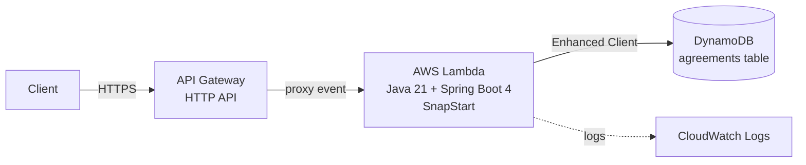
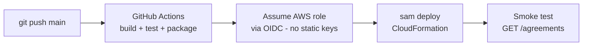

# Java_Spring_AWS_Lambda_demo

A serverless REST API for managing **insurance agreements**, built with **Java 21** and **Spring Boot 4**, running on **AWS Lambda** behind **API Gateway (HTTP API)**, persisting to **Amazon DynamoDB**, and deployed with **AWS SAM** from **GitHub Actions** on every push to `main`.

<!-- Uncomment once .github/workflows/ci-cd.yml is in place:

-->

---

## Project status

| Area | Status |
|---|---|
| Spring Boot 4 project + Lambda packaging (zip) | ✅ Done |
| Agreements API (controller, service, DynamoDB repository, error handling) | ✅ Done |
| Unit tests (service + controller) | ✅ Done |
| Infrastructure as code (`template.yaml`, AWS SAM) | ✅ Done |
| CI/CD (GitHub Actions + AWS OIDC, deploy on push to `main`) | ⏳ Planned |

---

## Architecture



**Delivery pipeline (planned):**



The application is a standard Spring MVC app. [`aws-serverless-java-container`](https://github.com/aws/serverless-java-container) translates API Gateway events into servlet requests, so controllers are plain `@RestController` classes, portable to any servlet runtime.

---

## Tech stack

| Layer | Technology |
|---|---|
| Language / runtime | Java 21 (AWS Lambda `java21`, arm64) |
| Framework | Spring Boot 4.1, Spring MVC, Bean Validation |
| Lambda adapter | `aws-serverless-java-container-springboot4` |
| Persistence | Amazon DynamoDB via AWS SDK v2 Enhanced Client |
| HTTP client | `url-connection-client` (lighter, faster init than Netty/Apache) |
| Boilerplate | Lombok (entities, constructor injection); Java records for API DTOs |
| Build | Maven (wrapper included), assembly plugin → Lambda zip |
| IaC / deploy | AWS SAM, GitHub Actions, AWS IAM OIDC federation |

---

## API

Base path: `/agreements`

| Method | Path | Description | Success | Errors |
|---|---|---|---|---|
| `POST` | `/agreements` | Create an agreement | `201 Created` + `Location` header | `400`, `409` |
| `GET` | `/agreements/{id}` | Get one agreement | `200 OK` | `404` |
| `GET` | `/agreements` | List agreements (max 100) | `200 OK` | — |
| `DELETE` | `/agreements/{id}` | Delete an agreement | `204 No Content` | `404` |

### Create request

```json
{
  "policyNumber": "POL-1001",
  "holderName": "Jane Doe",
  "productType": "HEALTH",
  "monthlyPremium": 120.50,
  "startDate": "2026-11-01",
  "endDate": "2027-11-01"
}
```

| Field | Rules |
|---|---|
| `policyNumber` | required, max 40 chars |
| `holderName` | required, max 120 chars |
| `productType` | required: `LIFE`, `HEALTH`, `DENTAL`, `DISABILITY`, `TRAVEL` |
| `monthlyPremium` | required, > 0, up to 10 integer digits and 2 decimals |
| `startDate` | required, ISO date |
| `endDate` | optional, must be after `startDate` |

### Response

```json
{
  "id": "6f1c2b9e-3a7d-4c1e-9f52-2d8e4b7a1c03",
  "policyNumber": "POL-1001",
  "holderName": "Jane Doe",
  "productType": "HEALTH",
  "monthlyPremium": 120.50,
  "startDate": "2026-11-01",
  "endDate": "2027-11-01",
  "status": "PENDING",
  "createdAt": "2026-10-15T19:30:00Z"
}
```

`status` is derived on creation: `PENDING` if `startDate` is in the future, otherwise `ACTIVE`.

### Errors

Errors follow [RFC 9457 Problem Details](https://www.rfc-editor.org/rfc/rfc9457):

```json
{
  "type": "about:blank",
  "title": "Not Found",
  "status": 404,
  "detail": "Agreement 6f1c2b9e-... not found",
  "instance": "/agreements/6f1c2b9e-..."
}
```

---

## Project structure

```
src/main/java/com/dannyleviev/lambdademo/
├── Application.java              # Spring Boot entry point
├── StreamLambdaHandler.java      # AWS Lambda entry point
├── config/
│   └── AppConfig.java            # DynamoDB clients, Clock
└── agreement/
    ├── AgreementController.java  # REST endpoints
    ├── AgreementService.java     # business logic
    ├── AgreementRepository.java  # DynamoDB access
    ├── AgreementItem.java        # DynamoDB entity (Lombok)
    ├── CreateAgreementRequest.java   # request DTO (record + validation)
    ├── AgreementResponse.java    # response DTO (record)
    ├── ProductType.java / AgreementStatus.java
    ├── AgreementNotFoundException.java
    └── GlobalExceptionHandler.java   # ProblemDetail error mapping
src/assembly/lambda-package.xml   # Lambda zip layout (classes + lib/)
```

---

## Build locally

**Prerequisites:** JDK 21, Git. (Maven is provided by the wrapper.)

```bash
# Linux / macOS
./mvnw clean verify

# Windows (PowerShell)
.\mvnw.cmd clean verify
```

Output: `target/java-spring-aws-lambda-demo-lambda-package.zip` — the artifact deployed to Lambda (classes at the root, runtime dependencies in `lib/`).

---

## Deployment (planned)

Deployment is fully automated, with no long-lived AWS credentials stored in GitHub:

1. Push to `main` triggers GitHub Actions.
2. The workflow builds, tests and packages the zip.
3. It assumes an AWS IAM role through **OIDC federation**; the role trusts only this repository's `main` branch.
4. `sam deploy` creates or updates the CloudFormation stack `java-spring-aws-lambda-demo`: the Lambda function, the HTTP API and the DynamoDB table.
5. A smoke test calls the deployed API.

Pull requests run build and tests only.

---

## Design decisions

- **Spring MVC on Lambda through a container adapter** rather than Spring Cloud Function: the code stays idiomatic and portable, and it can move to ECS/EKS unchanged.
- **SnapStart** on Java 21 removes most Spring cold-start latency without GraalVM native-image complexity.
- **Conditional writes** (`attribute_not_exists(id)`) mean an existing agreement can never be silently overwritten.
- **Strongly consistent reads** for `GET /{id}` guarantee read-after-write right after `POST`.
- **`GET /agreements` uses a bounded Scan**, which is acceptable at demo scale. At production scale this becomes a GSI query with cursor-based pagination.
- **Records for API DTOs, Lombok for the persistence entity:** the API contract is immutable, and the DynamoDB bean schema needs getters and setters.
- **PII-safe logging:** logs carry agreement IDs only, never holder names.
- **Injected `Clock`** makes time-dependent logic deterministic in tests.

---

## Cost & cleanup

At demo traffic the stack (Lambda + HTTP API + on-demand DynamoDB) runs within or near the AWS free tier. To remove everything:

```bash
sam delete --stack-name java-spring-aws-lambda-demo
```

---

## Author

**Danny Leviev** — Senior Backend Engineer (Java / Spring Boot / Kafka / AWS)
[LinkedIn](https://www.linkedin.com/in/danny-leviev) · [GitHub](https://github.com/DannyLeviev)